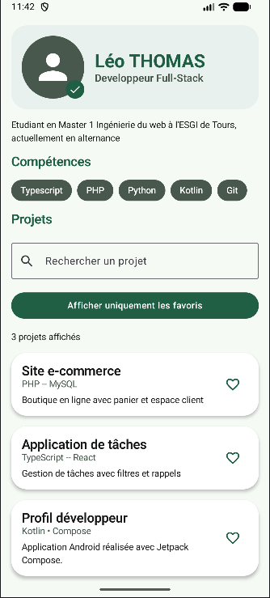
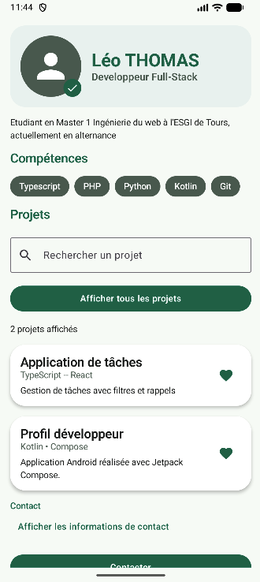

# Profil développeur interactif

## Description

Cette application Android présente le profil d'un développeur sous forme de petit portfolio
interactif, avec Jetpack Compose. L'utilisateur peut rechercher un projet
(par titre, technologie ou description), marquer des projets comme favoris, n'afficher que les
favoris et voir le nombre de projets affichés, qui se met à jour en direct. Il peut aussi
afficher ou masquer les informations de contact. Les données sont locales, écrites dans le code
Kotlin.

## États gérés par l'application

État principal, regroupé dans `ProfilUiState` et géré par le ViewModel :
- `profil` : les informations du profil (nom, rôle, description, compétences, contact)
- `projects` : la liste des projets **affichés** (déjà filtrée)
- `searchQuery` : le texte de recherche
- `showOnlyFavorites` : le filtre « favoris uniquement »
- `favoriteProjectIds` : les identifiants des projets favoris

État local, dans un composable :
- `showContactInfo` : afficher ou masquer les informations de contact

## État local

`showContactInfo` directement dans le composable `ContactSection`, avec `rememberSaveable`. C'est un état purement visuel : aucun autre composant n'en a besoin et il
ne fait pas partie des données du profil, donc le mettre dans le ViewModel n'apporterait rien.
`rememberSaveable` permet de le conserver lors d'une rotation de l'écran.

## State Hoisting

`ProfilScreen` est stateless : il ne contient ni `remember`, ni ViewModel, ni StateFlow. Il reçoit
toutes les valeurs à afficher en paramètres (`profil`, `projects`, `searchQuery`,
`showOnlyFavorites`, `favoriteProjectIds`) et les actions sous forme de callbacks
(`onSearchQueryChange`, `onToggleFavoriteFilter`, `onFavoriteClick`, `onContactClick`).
Il ne décide donc pas où l'état est stocké. C'est aussi ce qui permet de le prévisualiser
directement avec des valeurs fixes.

## ViewModel

`ProfilViewModel` possède l'état principal de l'écran et la logique qui le modifie : il filtre les
projets selon la recherche et le filtre favoris, ajoute ou retire un favori, et republie un nouvel
état à chaque action. Il ne dépend d'aucun composant Compose.

## StateFlow

Le ViewModel garde l'état dans un `MutableStateFlow` privé (`_uiState`) et expose une version
publique en lecture seule (`uiState`). Quand l'utilisateur agit, une fonction du ViewModel produit
une nouvelle copie de `ProfilUiState` avec `update` et `copy`. Le container observe ce flux avec
`collectAsState()` : dès qu'un nouvel état est publié, Compose recompose les parties de
l'interface qui l'utilisent, sans qu'on ait à modifier l'écran à la main.

## Organisation du code

- `ProfilViewModel` : possède l'état, filtre les projets et traite les actions
- `ProfilUiState` : classe qui représente l'état complet de l'écran
- `ProfilContainer` : récupère le ViewModel, collecte le StateFlow, transmet valeurs et callbacks
- `ProfilScreen` : écran stateless (une `LazyColumn` complète)
- `ProfilHeader`, `ProfilAvatar` : en-tête et avatar avec badge
- `TechnologyChip` : une compétence (dans une `LazyRow`)
- `ProjectCard` : un projet, avec le bouton favori
- `ProjectSearchField`, `FavoriteFilterButton`, `ProjectCount` : recherche, filtre favoris, compteur
- `ContactSection`, `ContactField` : zone de contact avec l'état local

## Capture d'écran

